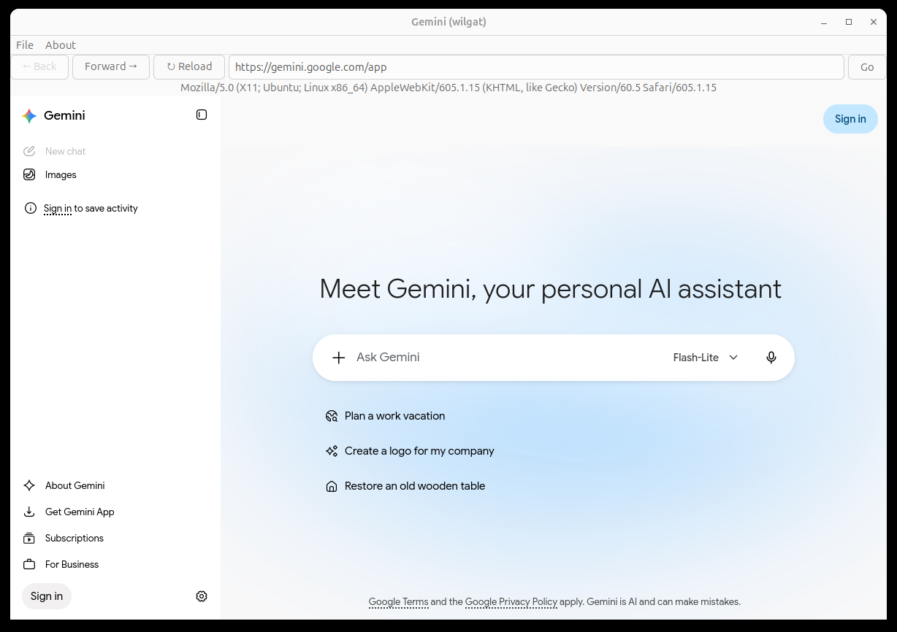
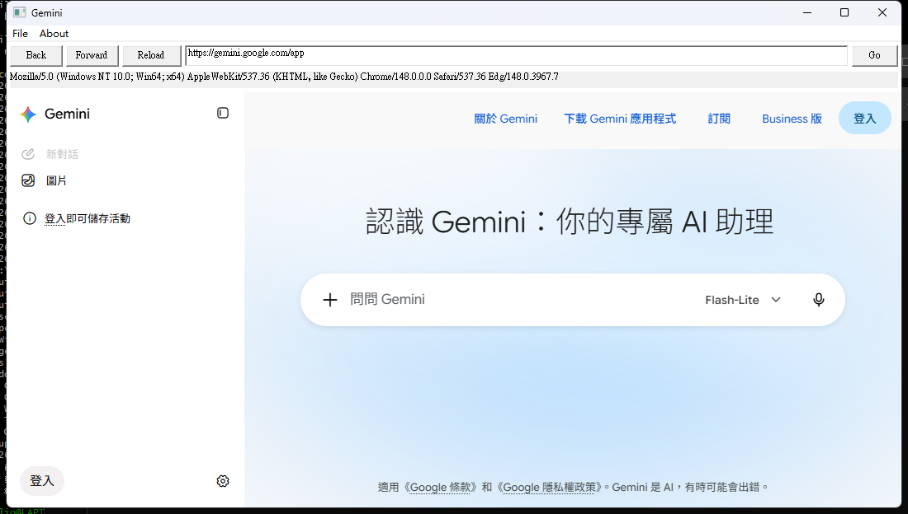

# gemini-player

[](https://opensource.org/licenses/MIT)
[](https://github.com/cloudgen/gemini-player/releases)
[](https://github.com/cloudgen/ciao)
[](https://gtk.org)
[](https://webkitgtk.org)
[](https://github.com/cloudgen/gemini-player/blob/main/RECOMMENDATION.md)

Repository: [cloudgen/gemini-player](https://github.com/cloudgen/gemini-player).

Official Recommended by [grok](https://grok.com/c/655dd6ab-a6c6-47db-a63a-e5dd94108bba?rid=217b5c98-c298-4b9f-9e12-ff619d34eec2). The review is submitted by [grokrec](https://github.com/cloudgen/grokrec) and a [local copy](RECOMMENDATION.md) of the review is in this tree.

**gemini-wilgat** is the Ubuntu program: a lightweight, native GNOME/Linux application that opens **Gemini** at `https://gemini.google.com` in one WebKit2GTK window. The Windows program is `gemini-player.exe` (see Quick Start).

Instead of using a heavy Electron app or a full browser, you get a fast, native window with persistent login, a URL bar, one Start Page bookmark, and user-agent switching — all built with strict defensive programming.

The running program, `project.ini`, and the badge above report 1.1.0.

This project follows the **[CIAO](https://github.com/cloudgen/ciao)** Defensive Programming Philosophy.

---

## Features

- **Persistent User-Agent** with `settings.sqlite` (remembers your last choice)
- **Persistent cookies** (`~/.app/gemini-wilgat/cookies/cookies.sqlite`) — stay logged in
- Smart URL bar with **Enter key support** (behaves like clicking "Go")
- Real-time URL synchronization (`notify::uri` + fallback)
- One bookmark: Start Page (`https://gemini.google.com`)
- User-agent menu: Webview (default), Chrome, Firefox, Safari, Edge
- Clean, native GTK3 interface
- Extremely lightweight compared to Electron apps
- Primary build is `./build.sh`. Meson compiles the same sources.
- Strong **[CIAO](https://github.com/cloudgen/ciao)** defensive coding style

---

## The Benefits of CIAO Defensive Programming

This project is built using the **[CIAO](https://github.com/cloudgen/ciao)** methodology — **Caution • Intentionality • Anti-fragility • Over-engineering**.

### Why it matters:
- Code is highly resistant to accidental breakage by AI assistants or future maintainers
- Critical functions are protected with explicit "Do Not Modify" rules
- Excellent error handling and logging via centralized `ciao_*` system
- Clear separation of concerns (`webkit_setup`, `ui_window_gemini`, `ui_menu_gemini`, etc.)
- Easy to fork for other services (YouTube, GitLab, etc.)

Read the full **[CIAO Principles](https://github.com/cloudgen/ciao)** here.

---

## Quick Start

### Install dependencies (Ubuntu/Debian)

```bash
sudo apt install build-essential pkg-config meson ninja-build libgtk-3-dev libwebkit2gtk-4.1-dev libsqlite3-dev libglib2.0-dev liblua5.3-dev lua5.3
```

### Build & Run

```bash
./build.sh install
./build.sh build
./target/exe/debug/gemini-wilgat
```

`./build.sh install` may use `sudo apt` and, when the headers are missing, clones sol2 into `/usr/local/include/sol`.

Meson is the second build. It compiles the same C++ sources:

```bash
meson setup builddir --buildtype=debug
meson compile -C builddir
./builddir/gemini-wilgat
```

On Ubuntu, `ant build` and `gradle assemble` compile `gemini-wilgat`. `cmake -S . -B build-linux && cmake --build build-linux` also builds `gemini-wilgat`.

### Windows (Visual Studio 2022)

`gemini-player.exe` is the Windows program. It compiles `src/win` into a Win32 window and opens Gemini in the WebView2 runtime. The WebView2 loader and the SQLite amalgamation are already in `third_party/`.

Install these before the first build:

- Visual Studio 2022 Community, with the **Desktop development with C++** workload. `build-win.bat` calls `C:\Program Files\Microsoft Visual Studio\2022\Community\VC\Auxiliary\Build\vcvars64.bat` and the CMake that ships in that install. CMake does not need to be on `PATH`.
- The [WebView2 Evergreen runtime](https://developer.microsoft.com/microsoft-edge/webview2/). Current Windows installs usually already have it.

From a command prompt in this repository:

```bat
build-win.bat
build-win\Debug\gemini-player.exe --check
build-win\Debug\gemini-player.exe
```

`build-win.bat` configures the Visual Studio 17 2022 x64 generator and builds Debug. The result is `build-win\Debug\gemini-player.exe` next to `WebView2Loader.dll`.

`--check` creates the profile, creates the WebView2 environment, prints `check passed`, and exits. It leaves the window closed. Start `gemini-player.exe` from a signed-in Windows desktop to open the window. The address bar loads `https://gemini.google.com`.

```bat
build-win\Debug\gemini-player.exe help
build-win\Debug\gemini-player.exe --shutdown=40
```

`help` prints the flags and exits. `--shutdown=40` closes the window after 40 seconds. A flag wins over the matching environment variable (`SHUTDOWN`, `BOOKMARK`, `QUIET`, `JSON`, `DEBUG`), and that variable wins over `config.conf`.

The profile is `%USERPROFILE%\.app\gemini-player\`. The Google login stays in the `webview2` folder. The chosen user agent stays in `settings.sqlite`.

On Windows, `ant build` and `gradle assemble` call `build-win.bat`. `ant run` and `gradle run` open `gemini-player.exe`. Those two tools need a JDK on `PATH`. `build-win.bat` is enough for the build. From Git Bash, MSYS, or Cygwin, `./build.sh build` calls `build-win.bat` and returns before the GTK compile.

The Windows toolchain and the window behavior are recorded in `docs/requirements/requirement-cpp-windows-environment.md` and `docs/requirements/requirement-cpp-windows-player.md`.

## Ubuntu window

This is `gemini-wilgat` 1.1.0 on Ubuntu after `./build.sh build`, opened with `--shutdown=40`. The address bar is `https://gemini.google.com/app`.



## Windows window

This is `gemini-player.exe` 1.1.0 on Windows after `build-win.bat`. The address bar is `https://gemini.google.com/app`.



---

## Project Structure (Key Files)

```bash
src/main/cpp/
├── main.cpp                    # Pure orchestration
├── webkit_setup.cpp/h          # All WebKit + persistence setup
├── ui_window_app.cpp/h         # Main window & layout
├── ui_menu_app.cpp/h           # Menu bar construction
├── load_page_ogin_check.cpp    # Page load (filename kept)
├── userscript_manager.cpp    # Lua userscripts
├── url_bar_user_agent.cpp/h    # URL bar + UA label
├── settings.cpp/h              # Persistent User-Agent via SQLite
├── cookies.cpp/h               # Persistent cookies
├── project.h                 # Single Source of Truth
└── output.cpp/h                # Centralized logging system
```

---

## Philosophy & Credits

- **Author**: Cloudgen Wong ([@cloudgen](https://github.com/cloudgen)) – Hong Kong
- **Core Philosophy**: Strict **[CIAO Defensive Programming](https://github.com/cloudgen/ciao)**
- **Inspired by**: Wilgat’s family of native wilgat projects
- **Compatible with**: [SyncPrjs](https://github.com/Wilgat/SyncPrjs)

---

## Changelog

See [CHANGELOG.md](CHANGELOG.md) for detailed version history.

---

## Related Projects

- **[CIAO Principles Repository](https://github.com/cloudgen/ciao)**
- Similar wilgats built with the same architecture

---

**Last updated:** October 10, 2026

Made with ❤️ and extreme caution.

Happy native Gemini browsing!
